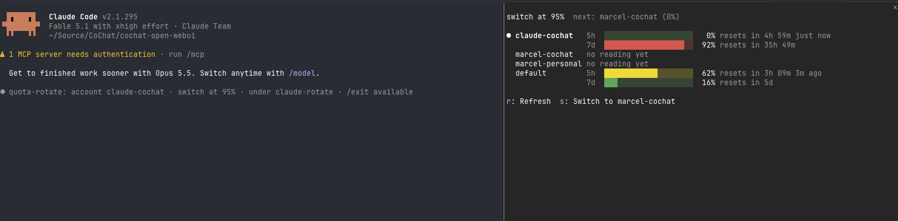

# quota-rotate

A Claude Code plugin for people with more than one Claude subscription. It shows the
usage windows of every account you own in one pane, and when the account a session runs
under reaches its limit, it moves the session to the account with the most headroom and
resumes it there.



- **One pane, every account.** `/quota` lists each account's 5-hour and 7-day windows,
  reset times, how old the reading is, and which account comes next.
- **Automatic handoff.** At 95 percent of any window (configurable), or the moment a turn
  dies on a rate limit, the session restarts under the next account and resumes with its
  whole conversation. A threshold handoff waits until the session is idle: no turn, no
  running agent, no background task.
- **Probes.** An idle account's reading is refreshed with a one-line headless run, so a
  handoff never trusts a blank or stale number.

## Requirements

- Claude Code 2.1.295 or newer, on macOS or Linux, in a terminal. The pane also draws in
  the desktop app, but the handoff needs the launcher, which is a terminal program.
- Node.js 22.18 or newer on your PATH (the launcher's account picker is a `.ts` file).
- Subscription logins (Pro, Max, Team). Claude Code reports usage windows only for
  subscriptions; a Console or API-key login has none to track.

## Install

Three steps, about two minutes, plus one browser login per account.

**1. Install the plugin** in a Claude Code session, at the user scope:

```
/plugin install quota-rotate --marketplace marcelfolaron/quota-rotate
```

Answer `y` to add the marketplace, keep the user scope, keep the default threshold or set
your own. The pane opens in that session.

**2. Put the launcher on your PATH**, in the same session:

```
/quota-setup
```

This writes three small shims to `~/.local/bin`: `cr` (the launcher), `claude-rotate`
(its long name) and `quota-accounts`. The shims find the plugin wherever Claude Code
keeps it, so they survive plugin updates. If `~/.local/bin` is not on your PATH, the
command prints the line to add to your shell profile.

**3. Register your accounts** from a terminal. Each `add` opens the browser login once;
pick the right claude.ai account there.

```bash
quota-accounts add default     # the login already in ~/.claude
quota-accounts add work        # any name you like, one per account
quota-accounts add personal
quota-accounts list
```

Then start Claude Code with `cr` instead of `claude`:

```bash
cr                      # picks the account with the most headroom
cr --account work       # or name one
cr --model opus         # everything else goes to claude
cr --resume             # the session picker; every account sees every session
cr -r <id|name>         # resume one session; cr -c continues the latest here
```

Start each new account once by hand (`cr --account work`) before relying on a handoff
into it: the first start in a fresh config directory can show the onboarding and the
workspace-trust prompts, and those would sit in front of a resumed session.

## In a session

| Command | What it does |
| --- | --- |
| `/quota` | Opens the pane. `r` refreshes, `p` probes the other accounts, `s` switches to the next account now. |
| `/quota-switch [account]` | Hands the session off now, to the named account or the emptiest. |
| `/quota-probe [account]` | Refreshes the other accounts' readings with one headless run each. |
| `/quota-setup` | Writes or repairs the `cr` shims. |
| `/config` | `Switch at (%)`: the threshold, 50 to 100. 100 waits for the hard limit. |

The status line shows the current account's percentage from 70 percent on, and what a
pending switch is waiting for.

## How a handoff works

```
 session under "work"                      claude-rotate (the launcher)
 ────────────────────────────────────      ─────────────────────────────────────
 every turn: record work.json
 window reaches 95% ─► pick "personal"
 write handoff.<pid>.json {to, sessionId}
 wait until idle (turn, agents, tasks)
 toast, then SIGTERM to this process  ───► claude exits
                                           read the handoff, remove it
                                           claude --resume <sessionId>
                                             CLAUDE_CONFIG_DIR=~/.claude-accounts/personal
 session under "personal", same conversation
```

- `session.measure` fires after every turn and whenever a window moves a whole point; the
  mod writes this account's reading and compares the fullest window against the threshold.
- The next account is the registered one with the lowest fullest window. It must be at
  least 20 points below the threshold, so two full accounts never trade a session back
  and forth. A target whose reading is older than an hour is probed first.
- A threshold switch waits for the running turn, for running agents (`$.agent.list()`)
  and for background tasks (reported by the `Stop` hook), then goes. A rate-limit switch
  waits for the turn alone: agents on the same account are blocked too.
- The process ends with SIGTERM, which Claude Code treats as a normal session end. The
  `/exit` command is not used: with a background task running it opens a confirmation
  that nobody is there to answer.
- After a rate-limit handoff the relaunch sends one prompt asking Claude to continue; a
  threshold handoff resumes idle.
- Outside the launcher (plain `claude`) the mod still records and shows usage, and asks
  you to `/login` yourself when a switch is due. `/login` keeps the session in place but
  needs a click in the browser.

## Accounts on disk

```
~/.claude-accounts/
  accounts.json          registry: name -> configDir, email, orgId, orgName, enabled
  usage/<name>.json      last reading per account, written by that account's mod
  plugin-root            where the plugin lives right now, for the shims
  handoff.<pid>.json     one per running launcher, only during a handoff
  <name>/                a CLAUDE_CONFIG_DIR per extra account
```

Each extra account's directory holds its own login and little else: `projects/`,
`plugins/`, `skills/`, `commands/`, `agents/`, `settings.json`, `CLAUDE.md` and
`keybindings.json` are symlinks to `~/.claude`. Every account sees the same sessions,
plugins and settings, which is also why an installed quota-rotate loads under every
account without further setup.

`default` is `~/.claude` itself, run with `CLAUDE_CONFIG_DIR` **unset**. On macOS the
Keychain entry is keyed to the variable, so `CLAUDE_CONFIG_DIR=~/.claude` reads a
different, empty entry and reports "Not logged in". The scripts handle this.

The mod attributes a session to an account by the launcher's `QUOTA_ROTATE_ACCOUNT`, else
by the config directory, and then checks `claude auth status` against the registry's
email and organization, so a manual `/login` is attributed correctly.

## Probes

An account that has not run a session has no reading, and claude.ai web use on an idle
account is invisible. A probe is a one-line headless run under that account with the mod
loaded (`claude -p "Reply with the single word ok." --model haiku`), so that account's
own mod instance writes its file. About five seconds and one tiny Haiku request each.

- A session probes every other account whose reading is missing or older than six hours,
  shortly after start and then once a minute.
- Before a handoff, a target chosen on a reading older than an hour is probed first.
- `/quota-probe`, the pane's `p` key and `quota-accounts probe` do it on demand.
- `cr` probes accounts with no reading before its first pick (`QUOTA_ROTATE_NO_PROBE=1`
  skips that).

## Limits and caveats

- **Terms.** Several accounts per machine is documented by Anthropic ("Log in with
  multiple accounts", `CLAUDE_CONFIG_DIR`). Rotating between your own paid accounts to keep
  working past one account's window is not addressed by the Consumer Terms or the Usage
  Policy either way. Read both before relying on this.
- **Resuming with background agents.** If the session had background agents or tasks when
  it moved (a rate-limit handoff does not wait for them), Claude Code asks on resume
  whether to restart them. Answer the prompt and the session continues.
- **Readings age.** Between probes an idle account's reading can be up to six hours old;
  the pane colors the age when it is. A window whose reset time has passed counts as 0.
- **Task status is as fresh as the last turn.** The list of background tasks comes from
  the `Stop` hook, so a task that finished after the last turn ended still counts as
  running until the next turn ends. An idle session burns nothing while it waits.
- **`autoContinueAtUsageLimit`.** Claude Code's own setting (on by default) parks a session
  at a usage limit to wait for the reset. Under the launcher the threshold handoff
  normally fires first; to be safe set `"autoContinueAtUsageLimit": false` in the shared
  `settings.json`.
- **Tokens outrank logins.** Do not keep `CLAUDE_CODE_OAUTH_TOKEN` or `ANTHROPIC_API_KEY`
  in your shell: both override every account's login. The launcher unsets them for its run.
- **Headroom can run out.** When no other account is at least 20 points under the
  threshold, the session stays, the status line says so, and a toast repeats every ten
  minutes.
- **Terminal wrappers.** A terminal that ships its own `claude` wrapper (cmux does) can
  break `claude plugin test`; set `CLAUDE_BIN` to the real binary for the scripts and
  the mod.
- **Project-scope installs do not probe.** Probes run with `--setting-sources user`, so
  install at the user scope (the default).

## Without the marketplace

Clone the repository and run the scripts from it. The launcher loads the mod from the
clone (`CLAUDE_CODE_PLUGIN_DIRS`) whenever the plugin is not installed, and stops doing so
once it is, so the mod never runs twice.

```bash
git clone https://github.com/marcelfolaron/quota-rotate ~/quota-rotate
~/quota-rotate/scripts/quota-accounts add default
alias cr=~/quota-rotate/scripts/claude-rotate
```

`QUOTA_ROTATE_LOAD_PLUGIN_DIR=1` forces the clone to load even when a copy is installed
(for working on the mod); `=0` forces the installed copy. `QUOTA_ROTATE_BASE` moves the
accounts directory; `QUOTA_ROTATE_SWITCH_AT` sets the picker's threshold;
`QUOTA_ROTATE_RESUME_PROMPT` replaces the prompt sent after a rate-limit handoff.

## Develop

```bash
claude plugin validate --strict .     # manifest, marketplace, hooks module
claude plugin test .                  # hooks/*.test.ts: policy and the mod against a mocked host
bash tests/run.sh                     # the above plus the shell tests (fake claude, temp HOME)
claude --plugin-dir .                 # one session with the mod; saving a file hot-reloads it
```

The engine writes its API typings to `.claude-plugin/types/` the first time the mod
loads in a session (they are gitignored); after that `tsc -p .` type-checks the mod.
The shell tests need `node` and a bash of 3.2 or newer; they never call the real `claude`.

With a copy installed, `cr` uses that copy, not your checkout; run the checkout with
`QUOTA_ROTATE_LOAD_PLUGIN_DIR=1 cr` or `claude --plugin-dir .` while working on it.

**Releasing:** bump `version` in both `.claude-plugin/plugin.json` and
`.claude-plugin/marketplace.json`, commit, tag `v<version>`, push. Installed copies are
cached under their version, and `claude plugin update quota-rotate` fetches the new one.

## License

MIT, see [LICENSE](LICENSE).
